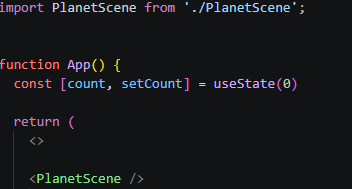

# javi-repo

Proyecto React + Vite con confeti (`canvas-confetti`) y escena 3D (`three`).

### Captura 1

confetti callendo

### Captura 2

confeti saliendo de un boton al pulsarlo

### Captura 3

pagina web con fondo 3d

codigo de el fondo 3d

fusion de el boton y el fondo
## Pregunta

**Si la carpeta `node_modules/` está excluida, ¿borrar una dependencia hace alguna acción sobre el repositorio? ¿Cuál?**

**Sí.** Aunque `node_modules/` esté excluida en `.gitignore`, borrar una dependencia (por ejemplo con `npm uninstall nombre-paquete`) modifica dos archivos que **sí** están versionados:

- **`package.json`**: se elimina la entrada de la dependencia en `dependencies` o `devDependencies`.
- **`package-lock.json`**: se eliminan el paquete y las dependencias transitivas que ya nadie necesita.

Por eso, tras desinstalar, `git status` muestra esos dos archivos como modificados y hay que hacer `git add` y `git commit` para que el cambio quede registrado en el repositorio.

La carpeta `node_modules/` en sí no genera ningún cambio en Git, porque está excluida. Si solo se borrara a mano la carpeta del paquete dentro de `node_modules/`, el repositorio no se enteraría de nada: `package.json` seguiría declarando la dependencia y cualquiera que clonara el proyecto y ejecutara `npm install` volvería a instalarla.

Esto es justo lo que permite que `node_modules/` no se suba: el repositorio guarda solo la **lista** de dependencias (`package.json` y `package-lock.json`), y cada persona reconstruye la carpeta con `npm install`.
